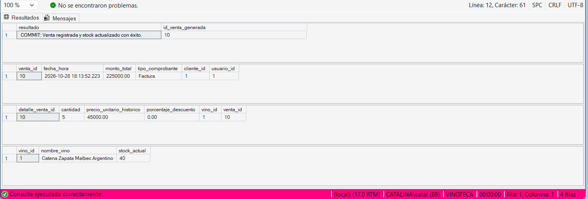
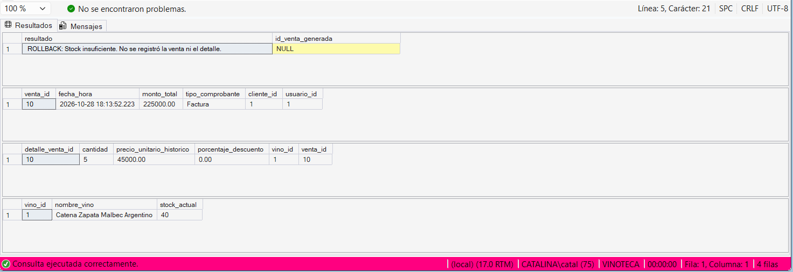

# 3. Implementación en SQL Server Express

En SQL Server Express, el control explícito de las transacciones se realiza mediante instrucciones de Transact-SQL (T-SQL). Para garantizar que las operaciones sobre la base de datos de la vinoteca se ejecuten de forma segura y se manejen los errores correctamente, la implementación se basa en sentencias de control combinadas con bloques de manejo de errores estructurado (`TRY...CATCH`).

## Sentencias de Control de Transacciones

*   **`BEGIN TRANSACTION` (o `BEGIN TRAN`):** Marca el punto de inicio explícito de la unidad lógica de trabajo. A partir de esta línea, SQL Server comienza a registrar las operaciones en el archivo de registro (Transaction Log) y aplica los bloqueos necesarios sobre los registros de las tablas afectadas (como `Venta`, `Detalle` o `Vino`).
*   **`COMMIT TRANSACTION` (o `COMMIT TRAN`):** Se ejecuta al final del proceso si todas las operaciones fueron exitosas. Marca la transacción como completada y hace que los cambios (como la rebaja del stock y el alta de la factura) sean permanentes en el disco y visibles para el resto de los usuarios.
*   **`ROLLBACK TRANSACTION` (o `ROLLBACK TRAN`):** Se invoca cuando ocurre una falla lógica (ej. validar que el `stock_actual` es menor a la `cantidad` solicitada) o un error de sistema. Deshace todos los cambios realizados desde el `BEGIN TRANSACTION`, liberando los bloqueos y restaurando los datos a su estado inicial.

## Estructura Recomendada (Buenas Prácticas en T-SQL)

Para evitar que una transacción quede abierta indefinidamente y bloquee las tablas si ocurre un error inesperado, la mejor práctica en SQL Server es envolver la transacción dentro de un Procedimiento Almacenado utilizando la siguiente estructura:

1.  **`SET XACT_ABORT ON;`**: Esta configuración obliga al motor a revertir automáticamente toda la transacción si ocurre un error grave en tiempo de ejecución (por ejemplo, una violación de clave foránea o un error de tipo de dato).
2.  **`BEGIN TRY ... END TRY`**: Contiene toda la lógica de negocio (`INSERT`, `UPDATE`, `DELETE`). Si todas las líneas se ejecutan con éxito, se llega al `COMMIT` al final del bloque.
3.  **`BEGIN CATCH ... END CATCH`**: Si alguna instrucción dentro del `TRY` falla, la ejecución salta inmediatamente al bloque `CATCH`. Aquí se captura el error y se ejecuta el `ROLLBACK`.
4.  **`@@TRANCOUNT`**: Es una variable global del sistema que devuelve el número de transacciones activas en la conexión actual. Es fundamental verificar que sea mayor a 0 antes de lanzar un `ROLLBACK`.

### Plantilla Base de Implementación

A continuación, se presenta la estructura esqueleto T-SQL sobre la cual se implementará la lógica de ventas:

```sql
CREATE PROCEDURE sp_Ejemplo_Transaccion
AS
BEGIN
    -- Evita enviar mensajes de conteo de filas a la aplicación (mejora rendimiento)
    SET NOCOUNT ON;
    
    -- Activa el rollback automático ante errores de ejecución de SQL
    SET XACT_ABORT ON;

    BEGIN TRY
        -- 1. Iniciar la transacción
        BEGIN TRANSACTION;

            -- [Aquí van las operaciones DML]
            -- Ej: INSERT en Venta...
            -- Ej: INSERT en Detalle...
            -- Ej: UPDATE en Vino (Descontar stock)...
            
            -- Lógica de validación:
            -- IF @stock_actual < @cantidad_pedida
            -- BEGIN
            --     -- Si se detecta una inconsistencia de negocio, se fuerza un error
            --     THROW 51000, 'Stock insuficiente para completar la venta.', 1;
            -- END

        -- 2. Si todo sale bien, confirmar los cambios
        COMMIT TRANSACTION;
    END TRY
    BEGIN CATCH
        -- 3. Si ocurre un error, verificar si la transacción sigue abierta y revertirla
        IF @@TRANCOUNT > 0
        BEGIN
            ROLLBACK TRANSACTION;
        END

        -- 4. Retornar el error a la aplicación que llamó al procedimiento
        DECLARE @ErrorMessage NVARCHAR(4000) = ERROR_MESSAGE();
        RAISERROR(@ErrorMessage, 16, 1);
    END CATCH
END;
```

Esta arquitectura de código asegura que la base de datos de la vinoteca nunca quede en un estado inconsistente, cumpliendo a la perfección con las propiedades ACID requeridas para un sistema comercial robusto.

# 5. Script de Demostración y Resultados Obtenidos

> **Nota:** Aunque la estructura con `TRY...CATCH` es la mejor práctica profesional (como se detalla en la Fase 3), para la demostración de la presente Fase se optó por implementar el flujo conceptual solicitado en la guía del proyecto. Esto permite visualizar de manera más didáctica y paso a paso la propiedad de atomicidad mediante el uso de condicionales (`IF`) antes de ejecutar las modificaciones definitivas en la base de datos.

El Procedimiento Almacenado principal que contiene esta lógica transaccional (`sp_RegistrarVenta`) fue implementado y cargado en el motor SQL Server. A continuación, se detallan los escenarios de validación ejecutados:

---

## Prueba 1: Venta Correcta (Producto con stock suficiente)

**Descripción del escenario:** 
En esta prueba, se simula a un cliente adquiriendo **5 unidades** del producto con ID 1 (cuyo stock inicial verificado es de 45 unidades). El objetivo es demostrar el escenario ideal donde se cumplen las reglas de negocio. El motor debe procesar la Unidad Lógica de Trabajo, ejecutar el `COMMIT` y retornar un mensaje de éxito. 
Como resultado esperado, se debe generar la cabecera de la venta, el registro en el detalle, y el catálogo de vinos debe actualizar su stock restando las 5 unidades.

**Ubicación del script de prueba:**  
`etapa-05/sql/prueba_venta_correcta.sql`

**Resultados obtenidos (Captura de pantalla):**



---

## Prueba 2: Venta Incorrecta (Producto con stock insuficiente)

**Descripción del escenario:** 
Este escenario es crítico para comprobar la propiedad de **Atomicidad** ("todo o nada"). Partiendo del stock restante (40 unidades tras la prueba anterior), se intenta procesar una nueva venta por **100 unidades** del mismo producto. 
El objetivo es demostrar que el sistema detecta la falta de disponibilidad y ejecuta un `ROLLBACK`. Lo que queremos validar es que el motor aborte la operación completa, emita un mensaje de error y, fundamentalmente, **no deje registros huérfanos** (es decir, no debe existir una cabecera de venta sin detalle, ni viceversa) manteniendo el stock completamente intacto en 40 unidades.

**Ubicación del script de prueba:**  
`etapa-05/sql/prueba_venta_incorrecta.sql`

**Resultados obtenidos (Captura de pantalla):**



